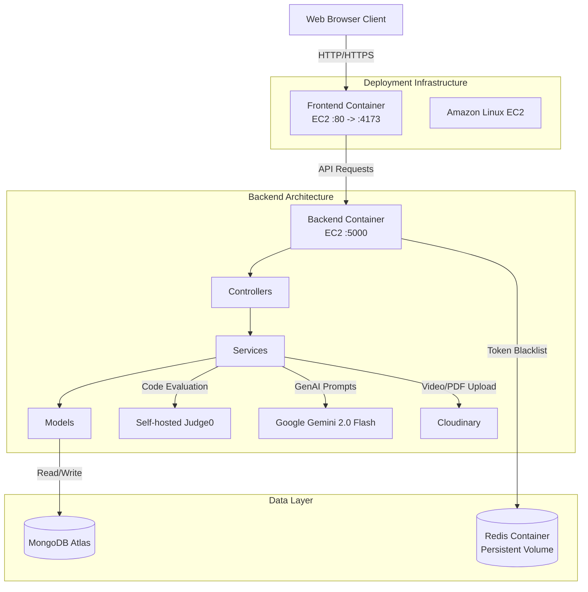

# High-Level Design (HLD)

## 1. System Overview

CodeSangram is an advanced MERN stack application offering dual functionality: a competitive coding platform and an AI-powered Interview Copilot. The system is designed to provide real-time code evaluation using Judge0 and simulate interactive voice-based behavioral and technical interviews using Google Gemini Flash 2.0.

### 1.1 Core Components

*   **Frontend (Client)**: React 19 (Vite) Single Page Application (SPA).
*   **Backend (API Server)**: Node.js with Express.
*   **Database**: MongoDB Atlas.
*   **Cache / Session Store**: Redis (upstash/cloud).
*   **Code Execution Engine**: Self-hosted Judge0.
*   **Storage (Media/Docs)**: Cloudinary.
*   **AI Engine**: Google Gemini API.

---

## 2. Architecture Diagram

---

## 3. Key Workflows & Subsystems

### 3.1 Authentication Flow
1.  **Login/Register**: User submits credentials to the `/auth` endpoints.
2.  **JWT Issue**: Backend hashes password (bcrypt), signs a JWT (1h expiration), and sets it as an `HttpOnly`, `Secure` cookie.
3.  **Validation**: `userMiddleware` intercepts requests, extracts the cookie, validates the JWT, and checks if the token is in the Redis Blacklist (for logged-out users).

### 3.2 Code Execution (Judge0)
1.  **Submission**: User writes code in the Monaco Editor and submits.
2.  **Batching**: Backend maps visible/hidden test cases and creates a batch request to Judge0.
3.  **Evaluation**: Judge0 runs the code securely in sandboxes and returns tokens.
4.  **Result Polling**: Backend requests results from Judge0 using tokens, compares stdout with expected output, and stores a `Submission` record in MongoDB.

### 3.3 AI Interview Copilot (Voice & Text)
1.  **Resume & JD Upload**: PDFs are uploaded to Cloudinary. Gemini reads the Cloudinary PDF URL to generate an `InterviewReport` context.
2.  **Voice Loop**:
    *   **Speech Recognition**: Browser uses `SpeechRecognition` (Web Speech API) to transcribe user speech to text.
    *   **Inference**: Text is sent to the backend `/generate-followup`. Gemini uses conversational memory (prior Q&A context) to generate a response.
    *   **Speech Synthesis**: The backend returns text, which the browser reads aloud using `SpeechSynthesis`.
3.  **Scorecard Generation**: At the end of the session, the backend compiles all Q&A into a prompt. Gemini outputs structured JSON (validated via JSON Schema) evaluating strengths, weaknesses, and a hire recommendation.

### 3.4 Dashboards & Analytics
1.  **Aggregation**: The dashboard aggregates data from `Submission`, `InterviewReport`, and `InterviewSession` collections.
2.  **Heatmap Generation**: User activity (Submissions and completed interviews) is converted into an activity map grouped by UTC dates, rendering GitHub-style contribution graphs.

---

## 4. Scalability & Deployment Strategy

*   **Runtime host**: The frontend, backend, and Redis containers run on an **Amazon Linux EC2** instance connected through the `algopilot-network` Docker network.
*   **Frontend**: The Vite production build is packaged into a Docker image and served with `vite preview` on container port `4173`, published as port `80` on EC2.
*   **Backend**: The Node.js service runs in a Docker container on port `5000`. Runtime configuration is loaded from `/home/ec2-user/backend.env`; application state remains external to the process.
*   **Redis**: Redis runs as a separate container with the `redis_data` named volume and `restart: unless-stopped`, providing token blacklisting and cache persistence across deployments.
*   **Database**: **MongoDB Atlas** handles replica sets automatically for high availability and failover.
*   **Media**: **Cloudinary** offloads bandwidth constraints for video editorials and resumes, saving server storage and network I/O.

### 4.1 CI/CD Pipeline

GitHub Actions provides path-scoped validation and manual production deployment:

1.  **Frontend CI** runs on pushes and pull requests targeting `main` when `frontend/**` or its workflow changes. It uses Node.js 20, runs `npm ci`, and builds the Vite application with the `VITE_API_URL` GitHub secret.
2.  **Backend CI** runs on pushes and pull requests targeting `main` when `backend/**` or its workflow changes. It uses Node.js 20, runs `npm ci`, and validates `index.js` with `node --check`.
3.  **EC2 deployment** is started manually with `workflow_dispatch`. The workflow builds backend and frontend Docker images, passes `VITE_API_URL` as the frontend build argument, combines the images into a TAR archive, copies it to EC2 over SCP, and replaces the application containers over SSH.
4.  The deployment requires the `VITE_API_URL`, `EC2_HOST`, and `EC2_SSH_KEY` GitHub secrets. Backend secrets are kept on EC2 in `/home/ec2-user/backend.env` and are not baked into the image.
