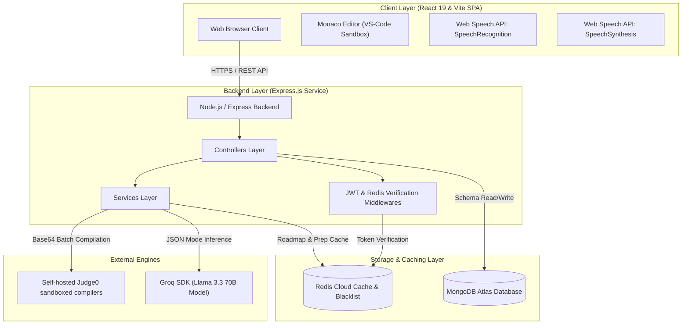
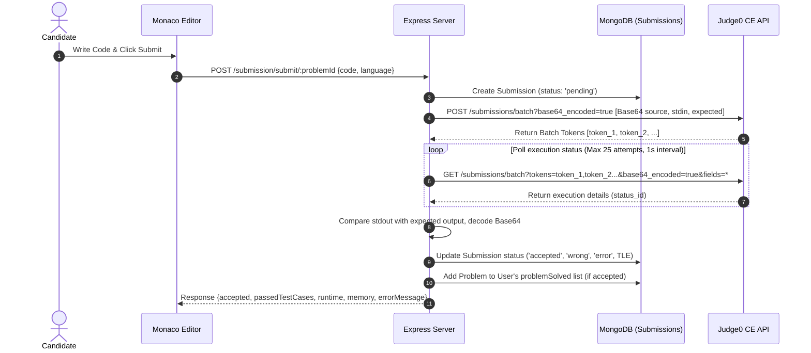
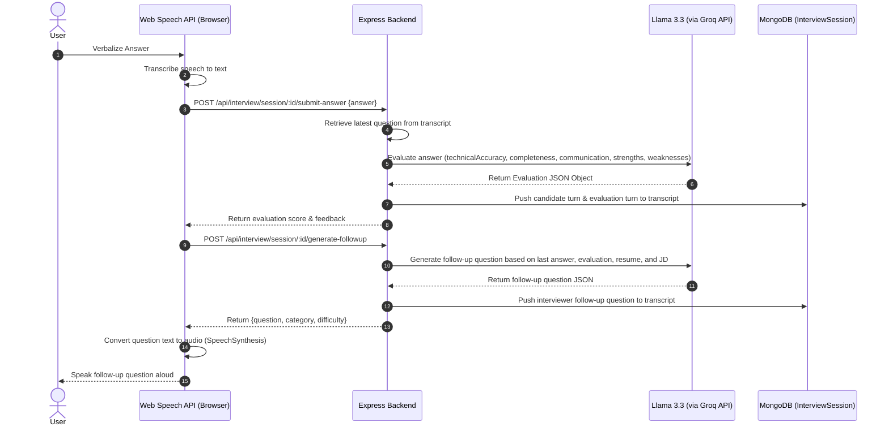

# ALGOPILOT — AI-Powered Competitive Coding & Mock Interview Platform

ALGOPILOT (formerly CodeSangram) is a production-ready, high-performance web platform designed to prepare developers for technical mock interviews, behavioral assessments, and competitive coding challenges. By combining a sandboxed, multi-language code execution engine with a real-time, voice-enabled conversational AI agent, ALGOPILOT bridges the gap between passive learning and realistic interview simulations.

---

## 1. Project Overview

Competitive coding platforms evaluate algorithmic correctness, while standard AI interview prep platforms offer simple text-based prompts. **ALGOPILOT** integrates both into a single cohesive ecosystem. It serves:
*   **Candidates**: Aspiring software engineers looking to practice coding rounds and verbalize their solutions under simulated pressure.
*   **Recruiters/Admins**: Technical administrators managing DSA problem lists, creating custom challenges, and uploading video editorials.

### Core Problems Solved
1.  **Passive Preparation vs. Active Performance**: Translating manual resume listings and target Job Descriptions (JDs) into custom interview loops.
2.  **Verbalization Gaps**: Transitioning seamlessly from speaking about design tradeoffs into a Monaco coding workspace.
3.  **Algorithmic Rigor**: Compiling and testing candidate code against hidden test cases in secure execution environments.
4.  **Feedback Latency**: Generating scorecards, identifying strengths and weaknesses, and generating structured learning roadmaps.

---

## 2. Architecture Deep Dive

ALGOPILOT uses a decoupled client-server architecture with dedicated layers for business logic, sandboxed execution, caching, database persistence, and AI inference.

### High-Level System Architecture



### Data Flow Diagrams

#### A. Code Execution Workflow (DSA Platform)


#### B. Mock Interview & Dynamic Voice Loop


---

## 3. Tech Stack & Selection Justification

Every technology chosen for ALGOPILOT matches production-grade, highly available engineering requirements.

| Technology | Role in Platform | Why Chosen | Trade-offs & Alternatives Considered |
| :--- | :--- | :--- | :--- |
| **React 19** | Frontend Framework | Declarative UI updates, native hooks, fast virtual DOM, and compatibility with modern browser packages. | Considered Next.js, but Vite + React SPA was selected to maintain a zero-cold-start client and rely on browser-level client-side routing. |
| **Direct Groq SDK** | AI Inference Engine | Extremely fast token-per-second output. Enables real-time conversational voice loops by fetching model outputs in under 200ms. | Evaluated **LangChain**. Direct integration with `groq-sdk` was preferred to minimize package dependencies, avoid library wrapper latency, and maintain complete control over backoff retries and payload formatting. |
| **Llama 3.3 70B** | Primary LLM (via Groq) | Powerful reasoning capabilities, high compliance with strict JSON formats, and a 128k context window to ingest long resumes and JDs. | Considered GPT-4o, but Llama 3.3 70B on Groq provided comparable reasoning speeds at a fraction of the cost, making it ideal for mock interview loops. |
| **Judge0 (CE)** | Sandboxed Compiler | Standard sandbox execution engine that evaluates code securely across languages (JS, C++, Java) without local container overhead. | Considered custom Docker container spin-ups. Dropped due to container orchestration complexity, cold starts, and resource constraints on the backend. |
| **Redis Cloud** | Caching & Session Blacklist | Low-latency in-memory data store. Cuts roadmap and preparation hub generation latencies by 99% by serving pre-computed JSON payloads. | Considered in-memory server arrays. Rejected due to scaling limitations; Redis allows multiple horizontally scaled backend nodes to share cache states. |
| **MongoDB Atlas** | Primary Database | Flexible document schema model ideal for tracking varying transcripts, parsed resumes, and dynamic scorecard structures. | Considered PostgreSQL. NoSQL was preferred because interview transcripts and resume schemas change dynamically based on template selections. |
| **Web Speech API** | Voice Interface | Zero-cost native browser voice recognition and speech synthesis. No third-party network audio streaming charges. | Considered ElevenLabs and Whisper. Web Speech API was chosen because it executes directly on the client, avoiding backend server audio upload latency. |

---

## 4. Feature Breakdown

### A. Sandboxed Code Execution Engine (Judge0 + Monaco)
*   **What it does**: Provides a code editor workspace ([frontend/src/pages/interview/CodingInterviewWorkspace.jsx](file:///d:/jyv/ALGOPILOT/frontend/src/pages/interview/CodingInterviewWorkspace.jsx)) where candidates solve algorithmic challenges. Code is batched, executed remotely, and verified against edge cases.
*   **How it works technically**:
    1.  The frontend loads starter code based on selected language (JavaScript uses `fs.readFileSync(0, 'utf8')` to parse stdin, C++ uses `cin`, Java uses `Main` class parsing).
    2.  `submitCode` in [backend/src/controllers/userSubmission.js](file:///d:/jyv/ALGOPILOT/backend/src/controllers/userSubmission.js) maps test cases from `hiddenTestCases` to a payload.
    3.  [backend/src/utils/problemUtility.js](file:///d:/jyv/ALGOPILOT/backend/src/utils/problemUtility.js#L19-L55) encodes the source code, input values, and expected outputs in Base64 using `Buffer.from(val).toString('base64')` to prevent encoding bugs.
    4.  It submits a batch request via `POST ${JUDGE0_URL}/submissions/batch?base64_encoded=true`.
    5.  It polls the API up to 25 times at 1s intervals. Once all tokens report `status_id > 2` (execution done), stdout/stderr outputs are decoded back to UTF-8.
    6.  Results are validated. If any test case reports a status other than `3` (Accepted), execution stops, returning compile errors (6), runtime errors (ex. 4), or Time Limit Exceeded (5).
*   **Files Responsible**:
    *   [backend/src/controllers/userSubmission.js](file:///d:/jyv/ALGOPILOT/backend/src/controllers/userSubmission.js)
    *   [backend/src/utils/problemUtility.js](file:///d:/jyv/ALGOPILOT/backend/src/utils/problemUtility.js)
    *   [frontend/src/pages/interview/CodingInterviewWorkspace.jsx](file:///d:/jyv/ALGOPILOT/frontend/src/pages/interview/CodingInterviewWorkspace.jsx)
*   **Edge Cases Handled**:
    *   **Infinite loops/hanging programs**: Handled by Judge0's automatic Time Limit Exceeded (TLE) constraints (status_id = 5).
    *   **Special character strings**: Avoided by encoding all code, inputs, and outputs in Base64 before network transmission.
    *   **Empty inputs**: Cleaned via standard trim utilities before batching.

### B. AI Coding Mentor
*   **What it does**: In-editor doubt-solver chatbot ([frontend/src/components/Chatai.jsx](file:///d:/jyv/ALGOPILOT/frontend/src/components/Chatai.jsx)) helping users solve DSA problems with progressive clues.
*   **How it works technically**:
    1.  The client sends current code, selected language, problem context, and chat logs to `/ai/chat`.
    2.  `solveDoubt.js` ([backend/src/controllers/solveDoubt.js](file:///d:/jyv/ALGOPILOT/backend/src/controllers/solveDoubt.js)) detects user intent via regex:
        *   **Code Review Intent**: Matches queries like `"where is the bug"`, `"why failing"`.
        *   **Optimization Intent**: Matches `"optimize"`, `"better approach"`.
        *   **Correctness Intent**: Matches `"is my solution correct"`.
    3.  A system instruction incorporates the problem title, description, constraints, visible test cases, starter code, user's current code, and history.
    4.  The prompt enforces **Progressive Hinting**:
        *   *Hint 1*: Conceptual clue (no code).
        *   *Hint 2*: Algorithmic clue (loops/logic structure).
        *   *Hint 3*: Structural clue (pseudocode outline).
        *   The complete solution is shared only when the user explicitly requests it.
*   **Files Responsible**:
    *   [backend/src/controllers/solveDoubt.js](file:///d:/jyv/ALGOPILOT/backend/src/controllers/solveDoubt.js)
    *   [backend/src/services/ai/aiProvider.js](file:///d:/jyv/ALGOPILOT/backend/src/services/ai/aiProvider.js)
*   **Edge Cases Handled**:
    *   **Irrelevant queries**: System prompts restrict responses to the current DSA problem.
    *   **Empty active editor**: Returns a friendly message if the user asks for a code review without typing any logic.
    *   **LLM Hallucinations**: Prompt templates force JSON wrappers and structured Markdown to avoid free-form textual noise.

### C. Generative AI Mock Interviews
*   **What it does**: Evaluates and conducts mock interviews based on candidate's uploaded resume (PDF) and target Job Description (JD).
*   **How it works technically**:
    1.  PDF files are processed via `pdf-parse` to retrieve raw text.
    2.  [backend/src/services/interview/resumeParserService.js](file:///d:/jyv/ALGOPILOT/backend/src/services/interview/resumeParserService.js) feeds raw text to Llama 3.3 via Groq with a schema prompt to extract a structured JSON payload: `{ skills, projects, experience, education, summary }`.
    3.  [backend/src/services/interview/jdParserService.js](file:///d:/jyv/ALGOPILOT/backend/src/services/interview/jdParserService.js) parses target Job Descriptions into required skills, preferred skills, technologies, responsibilities, and experience.
    4.  [backend/src/services/interview/interviewAnalysisService.js](file:///d:/jyv/ALGOPILOT/backend/src/services/interview/interviewAnalysisService.js) compares both datasets to generate an `analysisData` document detailing strong areas, missing skills, matching skills, matchScore, and custom interview focus areas.
    5.  When a session is initialized, this context is stored in `InterviewSession`. Question generation requests dynamically load these fields to frame questions.
*   **Files Responsible**:
    *   [backend/src/services/interview/resumeParserService.js](file:///d:/jyv/ALGOPILOT/backend/src/services/interview/resumeParserService.js)
    *   [backend/src/services/interview/jdParserService.js](file:///d:/jyv/ALGOPILOT/backend/src/services/interview/jdParserService.js)
    *   [backend/src/services/interview/interviewAnalysisService.js](file:///d:/jyv/ALGOPILOT/backend/src/services/interview/interviewAnalysisService.js)
*   **Edge Cases Handled**:
    *   **Rate Limits / API Failures**: Both resume and JD parsers implement a **local regex and dictionary parser fallback** (`parseResumeLocally` & `parseJdLocally`). If the Groq API fails or throws a 429 error, the local parser scans the text using a skill dictionary and sections regex to return structured data, preventing server crashes.
    *   **Malformed JSON from LLM**: Handled by `repairJson` utilities that clean trailing commas and strip surrounding markdown quotes before calling `JSON.parse`.

### D. Real-Time Voice Interview
*   **What it does**: Provides a hands-free conversational mock interview loop using native browser voice APIs, transitioning smoothly from behavioral questions to live-coding challenges.
*   **How it works technically**:
    1.  **Speech Recognition**: [frontend/src/pages/interview/InterviewWorkspace.jsx](file:///d:/jyv/ALGOPILOT/frontend/src/pages/interview/InterviewWorkspace.jsx) instantiates `window.webkitSpeechRecognition`. Continuous mode is enabled (`continuous = true`) to prevent automatic shutoffs.
    2.  Transcription updates the answer input buffer dynamically.
    3.  **Submission & Evaluation**: The transcript is posted to `/api/interview/session/:id/submit-answer`.
    4.  `evaluateAnswerForSession` ([backend/src/services/interview/answerEvaluationService.js](file:///d:/jyv/ALGOPILOT/backend/src/services/interview/answerEvaluationService.js)) evaluates the response, scoring technical correctness, communication, and completeness.
    5.  **Dynamic Follow-up**: The client requests `/api/interview/session/:id/generate-followup`. The backend uses Llama 3.3 to formulate a natural follow-up question.
    6.  **Speech Synthesis**: The frontend initializes a new `SpeechSynthesisUtterance(questionText)` and calls `window.speechSynthesis.speak(utterance)`.
    7.  **Coding Transition**: If the template is `'coding'` or the interview template shifts topics, the client navigates the candidate to [frontend/src/pages/interview/CodingInterviewWorkspace.jsx](file:///d:/jyv/ALGOPILOT/frontend/src/pages/interview/CodingInterviewWorkspace.jsx), loading a Monaco workspace alongside the AI interviewer.
*   **Files Responsible**:
    *   [frontend/src/pages/interview/InterviewWorkspace.jsx](file:///d:/jyv/ALGOPILOT/frontend/src/pages/interview/InterviewWorkspace.jsx)
    *   [backend/src/controllers/interview/followUpQuestionController.js](file:///d:/jyv/ALGOPILOT/backend/src/controllers/interview/followUpQuestionController.js)
    *   [backend/src/services/interview/followUpQuestionService.js](file:///d:/jyv/ALGOPILOT/backend/src/services/interview/followUpQuestionService.js)
*   **Edge Cases Handled**:
    *   **Browser speech errors**: Handles permission denials (`not-allowed`), network disconnects, and silent pauses by showing clear notifications in the UI and enabling manual text input mode automatically.
    *   **Interrupted speech**: Prevents overlapping audio by calling `window.speechSynthesis.cancel()` before starting a new speak event or activating the microphone.

### E. Automated Learning Roadmaps
*   **What it does**: Aggregates a user's interview history, scorecards, and strengths/weaknesses to generate a customized preparation roadmap (7, 14, and 30-day plans).
*   **How it works technically**:
    1.  `getLearningRoadmap` in [backend/src/controllers/interview/learningRoadmapController.js](file:///d:/jyv/ALGOPILOT/backend/src/controllers/interview/learningRoadmapController.js) retrieves all `InterviewReport` and `InterviewSession` records for the logged-in user.
    2.  It calculates overall averages for communication, technical, project, and coding scores.
    3.  A summary is constructed listing top weaknesses, top recommendations, and selected templates.
    4.  This summary is sent to Llama 3.3 to generate a JSON response mapping focus areas, priority topics, recommended resources, and structured daily tasks.
*   **Files Responsible**:
    *   [backend/src/controllers/interview/learningRoadmapController.js](file:///d:/jyv/ALGOPILOT/backend/src/controllers/interview/learningRoadmapController.js)
    *   [backend/src/services/interview/learningRoadmapService.js](file:///d:/jyv/ALGOPILOT/backend/src/services/interview/learningRoadmapService.js)
*   **Edge Cases Handled**:
    *   **No history available**: Returns a `404` status with a `NO_REPORTS_AVAILABLE` code, prompting the user to complete at least one mock interview first.
    *   **LLM generation failure**: Includes a fallback roadmap generator (`generateLocalFallbackRoadmap`) that programmatically constructs a template roadmap using the candidate's database averages.

### F. Redis Caching Layer (99% Latency Reduction)
*   **How it works**: Heavy AI generation tasks (like roadmaps and preparation hubs) require substantial token processing, leading to request durations of ~15,000ms.
*   **Implementation Details**:
    1.  When a user requests their roadmap, the controller checks for a cached version:
        `const cacheKey = roadmap:${req.user._id}:${latestReportId}`
    2.  If `redisClient.get(cacheKey)` returns data, the server parses the stringified JSON and returns it in under **50ms**, bypassing the LLM pipeline entirely.
    3.  On cache misses, the LLM processes the query. The result is cached for 7 days:
        `await redisClient.setEx(cacheKey, 86400 * 7, JSON.stringify(roadmap))`
    4.  **Automatic Invalidation**: The cache key contains `latestReportId`. Since the key changes when the candidate completes a new interview, the old cache is invalidated automatically.
*   **Files Responsible**:
    *   [backend/src/config/redis.js](file:///d:/jyv/ALGOPILOT/backend/src/config/redis.js)
    *   [backend/src/controllers/interview/learningRoadmapController.js](file:///d:/jyv/ALGOPILOT/backend/src/controllers/interview/learningRoadmapController.js)
    *   [backend/src/controllers/interview/preparationHubController.js](file:///d:/jyv/ALGOPILOT/backend/src/controllers/interview/preparationHubController.js)

---

## 5. Database Schema

All database models are implemented using **Mongoose** (MongoDB).

```
   +--------------+           +------------------+           +-----------------+
   |    User      | 1       * |   Submission     | *       1 |     Problem     |
   |--------------|-----------|------------------|-----------|-----------------|
   | _id          |           | userId (Ref)     |           | _id             |
   | emailId (Idx)|           | problemId (Ref)  |           | title           |
   | password     |           | code             |           | description     |
   | role         |           | status           |           | difficulty      |
   +--------------+           | runtime          |           +-----------------+
          | 1                 +------------------+
          |
          | 1
   +--------------+ 1       1 +------------------+
   |  Analytics   |-----------| InterviewSession |
   |--------------|           |------------------|
   | userId (Ref) |           | userId (Ref)     |
   | totalMocks   |           | status           |
   | scores       |           | transcript (Sub) |
   +--------------+           +------------------+
                                      | 1
                                      |
                                      | 1
                              +------------------+
                              | InterviewReport  |
                              |------------------|
                              | sessionId (Ref)  |
                              | overallScore     |
                              | weaknesses       |
                              +------------------+
```

### A. User Collection (`users`)
Stores user profiles, roles, and problem tracking.
*   `firstName` (String, required, 3-20 chars): User's first name.
*   `lastName` (String, max 20 chars): User's last name.
*   `emailId` (String, required, unique, lowercase, trimmed): Email used for auth.
*   `age` (Number, 6-80): User's age.
*   `role` (String, enum: `['user', 'admin']`, default: `'user'`): Role-based access level.
*   `problemSolved` (Array of ObjectIds, ref: `'problem'`): Solved coding challenges.
*   `password` (String): Bcrypt hashed password.
*   `timestamps` (Mongoose automatic): `createdAt` and `updatedAt`.

### B. Problem Collection (`problems`)
Stores coding challenges.
*   `title` (String, required): Challenge title.
*   `description` (String, required): Challenge description.
*   `difficulty` (String, enum: `['easy', 'medium', 'hard']`, required): Problem level.
*   `tags` (String, enum, required): Topic tag (e.g. `'dp'`, `'greedy'`, `'bfs'`).
*   `visibleTestCases` (Array of objects): Example test cases shown to the user.
    *   `input` (String, required)
    *   `output` (String, required)
    *   `explanation` (String, required)
*   `hiddenTestCases` (Array of objects): Validation test cases executed by Judge0.
    *   `input` (String, required)
    *   `output` (String, required)
*   `startCode` (Array of objects): Language-specific starter code templates.
    *   `language` (String, required)
    *   `initialCode` (String, required)
*   `referenceSolution` (Array of objects): Reference solutions.
    *   `language` (String, required)
    *   `completeCode` (String, required)
*   `problemCreator` (ObjectId, ref: `'user'`, required): Author admin.
*   `video` (Object): Cloudinary meta data.
    *   `secureUrl` (String), `thumbnailUrl` (String), `duration` (Number), `cloudinaryPublicId` (String).

### C. Submission Collection (`submissions`)
Records user attempts on coding challenges.
*   `userId` (ObjectId, ref: `'user'`, required, indexed): Submitting user.
*   `problemId` (ObjectId, ref: `'problem'`, required, indexed): Attempted problem.
*   `code` (String, required): Source code.
*   `language` (String, enum: `['javascript', 'cpp', 'java']`, required): Language identifier.
*   `status` (String, enum: `['pending', 'accepted', 'wrong', 'error']`, default: `'pending'`): Status flag.
*   `runtime` (Number, default: 0): Execution time in milliseconds.
*   `memory` (Number, default: 0): Memory consumption in kilobytes (kB).
*   `errorMessage` (String, default: ''): Compilation error logs or stderr.
*   `testCasesPassed` (Number, default: 0): Count of successful test cases.
*   `testCasesTotal` (Number, default: 0): Total validation test cases.

### D. InterviewSession Collection (`interviewsessions`)
Tracks voice and coding mock sessions.
*   `userId` (ObjectId, ref: `'user'`, required, indexed): User in mock.
*   `interviewType` (String, required): Job role (e.g. `'Frontend Developer'`).
*   `templateType` (String, enum: `['technical', 'hr', 'genai', 'coding', 'full-mock']`): Template selection.
*   `status` (String, enum: `['in-progress', 'completed', 'cancelled', 'discarded']`): Progress status.
*   `resumeData` (Mixed, required): Extracted resume details snapshot.
*   `jdData` (Mixed, required): Extracted JD details snapshot.
*   `analysisData` (Mixed, required): Pre-mock resume comparison report.
*   `transcript` (Array of sub-documents): Conversation history logs.
    *   `role` (String, enum: `['interviewer', 'candidate', 'system', 'evaluation', 'coding-question', 'coding-submission', 'coding-evaluation']`)
    *   `message` / `code` / `executionResult` / `score` / `technicalAccuracy` / `communication` / `strengths` / `weaknesses` / `improvements` / `overallFeedback` / `timestamp`.
*   `questionCount` (Number, default: 0)
*   `answerCount` (Number, default: 0)
*   `followUpCount` (Number, default: 0)
*   `completionPercentage` (Number, 0-100)
*   `startedAt` (Date), `endedAt` (Date), `duration` (Number).

### E. InterviewReport Collection (`interviewreports`)
Stores mock interview scorecards.
*   `userId` (ObjectId, ref: `'user'`, required, indexed)
*   `sessionId` (ObjectId, ref: `'interviewSession'`, required, unique): Linked mock session.
*   `overallScore` (Number, 0-100)
*   `technicalScore` (Number, 0-100)
*   `communicationScore` (Number, 0-100)
*   `problemSolvingScore` (Number, 0-100)
*   `projectDiscussionScore` (Number, 0-100)
*   `codingScore` (Number, 0-100)
*   `strengths` / `weaknesses` / `recommendations` (Arrays of Strings)
*   `summary` (String): Final review.
*   `hireRecommendation` (String, enum: `['Strong Hire', 'Hire', 'Borderline', 'No Hire']`).

### F. InterviewAnalytics Collection (`interviewanalytics`)
Tracks longitudinal performance metrics.
*   `userId` (ObjectId, ref: `'user'`, required, unique, indexed)
*   `totalInterviews` (Number), `completedInterviews` (Number)
*   `scores` (Object): Average metrics (`averageTechnical`, `averageCommunication`, `averageCoding`, `averageOverall`).
*   `strongSkills` / `weakSkills` / `recommendations` (Arrays of Strings)
*   `skillTrends` (Array): Historical metrics over time.
*   `lastSessionId` (ObjectId), `lastReportId` (ObjectId), `lastInterviewAt` (Date).

### Indexing Strategy
*   **User Unique Index**: `emailId: 1` ensures emails remain unique.
*   **Submission Compound Index**: `submissionSchema.index({ userId: 1, problemId: 1 })` optimizes lookups for user attempts on specific problems.
*   **Session Indexes**: `interviewSessionSchema.index({ userId: 1, createdAt: -1 })` optimizes history and analytics rendering.
*   **Report Indexes**: `interviewReportSchema.index({ userId: 1, createdAt: -1 })` optimizes roadmap generations by picking the latest scorecard quickly.

---

## 6. API Documentation

All request bodies and responses are formatted in JSON. Protected routes require a valid signed JWT in the `token` cookie.

### A. Authentication Endpoints

#### Register User
*   **Path**: `POST /user/register`
*   **Auth**: Public
*   **Request Body**:
    ```json
    {
      "firstName": "John",
      "lastName": "Doe",
      "emailId": "john.doe@gmail.com",
      "password": "securepassword123",
      "age": 25
    }
    ```
*   **Response (200 OK)**:
    ```json
    {
      "message": "User registered successfully",
      "token": "eyJhbGciOi..."
    }
    ```

#### Login User
*   **Path**: `POST /user/login`
*   **Auth**: Public
*   **Request Body**:
    ```json
    {
      "emailId": "john.doe@gmail.com",
      "password": "securepassword123"
    }
    ```
*   **Response (200 OK)**: Sets an `HttpOnly` cookie named `token` containing the signed JWT.
    ```json
    {
      "message": "Login successful",
      "user": {
        "_id": "60d5ecb8b392...",
        "firstName": "John",
        "emailId": "john.doe@gmail.com",
        "role": "user"
      }
    }
    ```

#### Logout User
*   **Path**: `POST /user/logout`
*   **Auth**: JWT (User)
*   **Response (200 OK)**: Blacklists the token in Redis for its remaining time-to-live (TTL), clears the cookie, and returns:
    ```json
    {
      "message": "Logged out successfully"
    }
    ```

---

### B. Competitive Coding Endpoints

#### Get All Problems
*   **Path**: `GET /problem/getAllProblem`
*   **Auth**: JWT (User)
*   **Response (200 OK)**:
    ```json
    [
      {
        "_id": "651a2e3b1c...",
        "title": "Two Sum",
        "difficulty": "easy",
        "tags": "array",
        "description": "Given an array of integers..."
      }
    ]
    ```

#### Submit Solution
*   **Path**: `POST /submission/submit/:id`
*   **Auth**: JWT (User)
*   **Request Body**:
    ```json
    {
      "code": "function solve(input) { ... }",
      "language": "javascript"
    }
    ```
*   **Response (201 Created)**:
    ```json
    {
      "accepted": true,
      "totalTestCases": 12,
      "passedTestCases": 12,
      "runtime": 0.045,
      "memory": 1820,
      "status": "accepted",
      "errorMessage": null
    }
    ```

---

### C. AI Mock Interview Endpoints

#### Upload Resume PDF
*   **Path**: `POST /api/interview/resume/upload`
*   **Auth**: JWT (User)
*   **Request Body**: Multipart Form Data with key `resume` (PDF file, <= 5MB).
*   **Response (200 OK)**:
    ```json
    {
      "skills": ["React", "Node.js", "Express", "MongoDB"],
      "projects": ["Collaborative Workspace App"],
      "experience": ["SDE Intern at Acme Corp"],
      "education": ["B.Tech in Computer Science"],
      "summary": "Full Stack developer experienced in building scalable MERN solutions."
    }
    ```

#### Analyze Resume & JD
*   **Path**: `POST /api/interview/analyze`
*   **Auth**: JWT (User)
*   **Request Body**:
    ```json
    {
      "resumeData": { "skills": [...], "projects": [...] },
      "jdData": { "requiredSkills": [...], "technologies": [...] }
    }
    ```
*   **Response (200 OK)**:
    ```json
    {
      "matchScore": 75,
      "matchedSkills": ["React", "MongoDB"],
      "missingSkills": ["System Design", "Docker"],
      "strongAreas": ["Solid technical base and build experience in React."],
      "weakAreas": ["Familiarity gap identified in target requirement: Docker."],
      "interviewFocusAreas": ["Deep dive into standard implementations of React."],
      "recommendations": ["Revise standard Docker containers configurations."]
    }
    ```

#### Start Interview Session
*   **Path**: `POST /api/interview/session/start`
*   **Auth**: JWT (User)
*   **Request Body**:
    ```json
    {
      "interviewType": "MERN Developer",
      "templateType": "technical",
      "resumeData": { ... },
      "jdData": { ... },
      "analysisData": { ... }
    }
    ```
*   **Response (201 Created)**:
    ```json
    {
      "sessionId": "651a2ff41...",
      "status": "in-progress",
      "templateType": "technical"
    }
    ```

#### Generate Follow-up Question
*   **Path**: `POST /api/interview/session/:id/generate-followup`
*   **Auth**: JWT (User)
*   **Request Body**:
    ```json
    {
      "userAnswer": "I handle distributed sessions by saving state in Redis.",
      "codeContext": ""
    }
    ```
*   **Response (200 OK)**:
    ```json
    {
      "question": "How do you manage key eviction in Redis when database size limits are reached?",
      "category": "Backend",
      "difficulty": "hard",
      "reason": "Deep-dive into caching configurations."
    }
    ```

#### Generate Learning Roadmap
*   **Path**: `GET /api/interview/roadmap`
*   **Auth**: JWT (User)
*   **Response (200 OK)**: Checks Redis cache. Returns pre-computed payload on hits, or generates via LLM:
    ```json
    {
      "focusAreas": ["Distributed caching", "System architecture"],
      "priorityTopics": ["Redis eviction policies", "DB indexing"],
      "sevenDayPlan": ["Day 1: Study LRU/LFU cache policies...", "Day 2: Set up TTLs..."],
      "fourteenDayPlan": ["Week 1: Focus on databases...", "Week 2: Focus on caching..."],
      "thirtyDayPlan": ["Weeks 1-4: Systematic mock revision..."],
      "recommendedResources": ["Redis developer documentation"],
      "estimatedImprovement": "Expected score increase from 65% to 80% in 30 days.",
      "mentorAdvice": "Focus heavily on caching details."
    }
    ```

---

## 7. AI & ML Pipeline

ALGOPILOT processes resumes, target job descriptions, and conversation histories using a structured LLM orchestration pipeline.

```
       +-------------------+       +--------------------+
       |  Resume PDF File  |       | Job Description PDF|
       +---------+---------+       +---------+----------+
                 |                           |
                 v                           v
            pdf-parse                   pdf-parse
                 |                           |
                 +-------------+-------------+
                               |
                               v
                       Raw PDF Text Lines
                               |
                               v
                   Llama 3.3 (via Groq SDK)
                    - JSON Mode Enforced
                    - Fallback to Regex Parser
                               |
                               v
                       Structured Schemas
             (skills, projects, experience, keywords)
                               |
                               v
                     Comparison & Analysis
          (matchScore, strong/weak areas, recommendations)
                               |
                               v
                   Stored in InterviewSession
```

### Prompt Engineering Strategies
To ensure structured outputs and reduce latency, the system uses the following prompt engineering techniques:
1.  **JSON Mode Enforcement**: System instructions mandate JSON format output. The backend configures the Groq SDK with:
    `response_format = { type: 'json_object' }`
2.  **Structured Few-Shot Templates**: Prompt inputs structure data into clean blocks (e.g. `Analysis Summary`, `Interview Reports`, `Recent Interview Sessions`) using stringified JSON arrays.
3.  **Strict Context Bound**: Prompts contain explicit boundaries (e.g. `"Do NOT reveal the solution code if the user only asks for a hint."`, `"Stay strictly focused on the current problem: {title}."`) to prevent the LLM from generating irrelevant output.
4.  **Seed-Based Variety**: To prevent repetitive questions across sessions, a random seed is injected into the prompt dynamically:
    `Current Random Seed for Variety: ${Math.random().toString(36).substring(7)}`

---

## 8. Performance Optimizations

### A. Redis Caching Implementation (Roadmaps & Prep Hubs)
*   **Key Design**: Cache keys are bound to both the user ID and the latest scorecard ID:
    `const cacheKey = roadmap:${req.user._id}:${latestReportId}`
*   **Logic Flow**:
    ```
    Request Roadmap -> Check Cache Key -> [HIT] -> Parse & Return JSON (< 50ms)
                                       -> [MISS] -> Query LLM -> Cache Result -> Return (15s)
    ```
*   **TTL**: Roadmaps are cached for 7 days (`86400 * 7` seconds).
*   **Invalidation**: The key changes automatically when the user completes a new mock session (which generates a new report ID), ensuring they always receive an updated roadmap.

### B. Memory Storage for PDF Processing
Multer is configured to use memory storage (`multer.memoryStorage()`) instead of disk storage. PDF files are processed as buffers in RAM and parsed directly by `pdf-parse`, avoiding disk read/write latency.

### C. Async Database Updates
To prevent API blocking, user solve states are updated in the background. The server returns the Judge0 validation result to the client immediately, then updates the user's `problemSolved` array asynchronously.

---

## 9. Security Considerations

### A. Authentication Security
*   **Secure Cookies**: JWT tokens are issued with `httpOnly: true`, `secure: true` (in production), and `sameSite: 'none'`. This prevents XSS scripts from accessing session tokens.
*   **CORS Whitelist**: The backend restricts origins using a strict whitelist set by `process.env.FRONTEND_URL`.
*   **Redis Token Blacklist**: When users log out, their token is saved in Redis with a Time-To-Live (TTL) matching its remaining validity. Middleware checks this blacklist on every request to prevent reused tokens.

### B. Sandboxed Code Execution
*   **Isolated Sandboxes**: Code runs on Judge0 sandboxed environments, which restrict file system access, network requests, and system commands.
*   **Timeout Safeguards**: Max execution time is capped at 5 seconds per testcase to prevent CPU exhaustion.
*   **Payload Sanitization**: Code and testcase values are encoded in Base64 before transmission to prevent command injection.

---

## 10. Setup & Running Locally

### Prerequisites
*   Node.js (v18 or higher)
*   MongoDB instance (local or Atlas)
*   Redis server (local or Upstash)
*   Judge0 CE instance (local or self-hosted)
*   Groq API Key (from Groq Console)

### Environment Variables

#### Backend (`backend/.env`)
```env
PORT=3000
FRONTEND_URL=http://localhost:5714
DB_CONNECT_STRING=mongodb+srv://<username>:<password>@cluster.mongodb.net/algopilot
JWT_KEY=supersecretjwtkeysigninghere
REDIS_URL=redis://default:<password>@<host>:<port>
JUDGE0_URL=http://localhost:2358
GROQ_API_KEY=your_groq_console_api_key
```

#### Frontend (`frontend/.env`)
```env
VITE_API_URL=http://localhost:3000
```

### Step-by-Step Local Setup

1.  **Clone the repository**:
    ```bash
    git clone https://github.com/Pradeepmodak/CodeSangram.git
    cd CodeSangram
    ```

2.  **Set up the Backend**:
    ```bash
    cd backend
    npm install
    # Create .env and paste variables
    npm run dev
    ```

3.  **Set up the Frontend**:
    ```bash
    # Open a new terminal
    cd ../frontend
    npm install
    # Create .env and paste VITE_API_URL
    npm run dev
    ```

---

## 11. Known Limitations & Future Improvements

1.  **No Compilation Caching**: Every code submission runs all test cases, even if only a formatting change was made.
    *   *Improvement*: Implement hash checks on source code to skip execution if code matches a recent submission.
2.  **Browser-Dependent Speech Recognition**: The Web Speech API relies on browser-level implementations (Chrome provides the best accuracy, while Firefox supports limited continuous modes).
    *   *Improvement*: Integrate a unified server-side transcription API (like Whisper) for consistent cross-browser performance.
3.  **Static Test Cases**: Admin problems contain pre-configured test cases.
    *   *Improvement*: Integrate LLM agents to generate random, valid edge-case inputs dynamically during submissions.

---

## 12. Interview Q&A Section

### Q1: What is the high-level architecture of ALGOPILOT, and how do the components interact?
**Answer**: ALGOPILOT is built on the MERN stack with a decoupled React 19 (Vite) client and Node.js (Express) backend. The frontend handles code editing (Monaco) and voice processing (Web Speech API). The backend coordinates business logic, managing submissions, and orchestrating external API calls. MongoDB Atlas handles primary data persistence (profiles, sessions, reports), while Redis manages session blacklists and caches roadmaps. Code execution is offloaded to a self-hosted Judge0 instance, and AI mock evaluations run through Llama 3.3 using the Groq SDK.

### Q2: Why did the project decide to implement direct Groq SDK calls instead of using LangChain?
**Answer**: While LangChain provides useful abstractions, it adds dependency overhead, abstract tracing latency, and makes customizing retry loops difficult. Direct integration via the official `groq-sdk` allowed us to write a lightweight, high-performance wrapper ([backend/src/services/ai/aiProvider.js](file:///d:/jyv/ALGOPILOT/backend/src/services/ai/aiProvider.js)) that implements custom exponential backoff, parses JSON mode responses directly, and handles rate limits (429) cleanly with minimal latency.

### Q3: How exactly is the 99% latency reduction in the Learning Roadmap generation achieved?
**Answer**: Roadmap generation requires analyzing historical sessions and scorecards, taking up to 15 seconds via the LLM. To resolve this, we implemented a caching pattern in [backend/src/controllers/interview/learningRoadmapController.js](file:///d:/jyv/ALGOPILOT/backend/src/controllers/interview/learningRoadmapController.js#L106-L121). The cache key combines the user's ID with their latest scorecard ID (`roadmap:${req.user._id}:${latestReportId}`). On cache hits, Redis returns the pre-computed JSON in under 50ms. The cache invalidates automatically when the user completes a new interview, as a new report ID is generated.

### Q4: Explain the step-by-step data flow of a user code submission from the Monaco editor to the database.
**Answer**: 
1. The user clicks "Submit" in [frontend/src/pages/interview/CodingInterviewWorkspace.jsx](file:///d:/jyv/ALGOPILOT/frontend/src/pages/interview/CodingInterviewWorkspace.jsx).
2. The client posts the code and language identifier to `/api/interview/session/:id/submit-coding-solution`.
3. The backend creates a `Submission` document with a `'pending'` status.
4. `executeCodeWithJudge0` compiles the source code, expected outputs, and stdin inputs into Base64 strings to prevent serialization issues.
5. The payload is sent to `POST /submissions/batch?base64_encoded=true` on Judge0.
6. The backend polls the tokens until status IDs verify execution is complete.
7. Results are compared: if all status IDs are `3`, the submission is marked `'accepted'`; otherwise, compile, runtime, or timeout error flags are set.
8. The database updates the submission state, and the frontend displays the execution metrics.

### Q5: How does the platform prevent JWT session hijacking after a user logs out?
**Answer**: Since JWTs are stateless, clearing the browser cookie is not enough to revoke access. In [backend/src/controllers/userAuthent.js](file:///d:/jyv/ALGOPILOT/backend/src/controllers/userAuthent.js#L114), logging out extracts the JWT and stores it in Redis: `redisClient.set('token:' + token, 'Blocked', 'EX', timeUntilExpiry)`. The `userMiddleware` checks this blacklist: `redisClient.exists('token:' + token)`. If blacklisted, the request is rejected immediately, even if the signature is valid.

### Q6: How does the resume parser handle API rate limits (429) or JSON formatting errors from Groq?
**Answer**: [backend/src/services/interview/resumeParserService.js](file:///d:/jyv/ALGOPILOT/backend/src/services/interview/resumeParserService.js#L378-L389) implements a local fallback engine (`parseResumeLocally`). If the Groq API fails or returns invalid JSON, a catch block triggers the local regex parser. This fallback matches keywords against a dictionary of 30+ skills (e.g. React, Docker, SQL) and extracts education and project sections based on layout markers, keeping the upload pipeline functional.

### Q7: Why did you choose MongoDB over a SQL database like PostgreSQL for this application?
**Answer**: The core entities in our system, particularly `InterviewSession` and its `transcript` turns, are document-centric. Transcript turns contain varying structures: some represent behavioral questions (simple text), others represent coding tasks (descriptions, constraints, stdin examples), and others store execution results or AI evaluations. Storing this in a relational database would require complex joins or JSONB columns. MongoDB allows us to save the entire session timeline as a single document, simplifying queries and updates.

### Q8: How does the application implement input sanitization for Judge0 code execution?
**Answer**: Letting users execute arbitrary code on remote servers carries risk. We implement security at two levels: first, Judge0 runs the code inside isolated sandboxes with disabled network access and file system write restrictions. Second, [backend/src/utils/problemUtility.js](file:///d:/jyv/ALGOPILOT/backend/src/utils/problemUtility.js#L20-L25) encodes all code and stdin data into Base64 before sending the HTTP request, preventing command injection attacks.

### Q9: How is the database indexing strategy structured to optimize submission queries?
**Answer**: Users frequently fetch their historical attempts for specific coding challenges. To optimize these reads, [backend/src/models/submission.js](file:///d:/jyv/ALGOPILOT/backend/src/models/submission.js#L57) defines a compound index on user and problem IDs: `submissionSchema.index({ userId: 1, problemId: 1 })`. This index allows Mongoose to retrieve submission histories without scanning the entire collection.

### Q10: How does the voice interview loop work in browser clients without incurring backend audio storage costs?
**Answer**: Processing audio files on servers is expensive and adds network latency. ALGOPILOT handles audio processing entirely on the client side using the browser's native **Web Speech API**. The client transcribes speech to text using `webkitSpeechRecognition` and converts text back to speech with `window.speechSynthesis.speak()`. The backend only processes text strings, eliminating audio storage costs and processing latency.

### Q11: What is the purpose of `dropProblemIndex.js` in your utility folder?
**Answer**: During early development, a unique index was accidentally created on the `problemSolved` array field in the User model. In MongoDB, a unique index on an array prevents multiple users from having identical values (e.g. if two users solve the same problem). [backend/src/utils/dropProblemIndex.js](file:///d:/jyv/ALGOPILOT/backend/src/utils/dropProblemIndex.js) drops this index (`problemSolved_1`) on startup to allow users to update their solved arrays independently.

### Q12: How do you prevent Llama 3.3 from repeating the same questions during mock interview sessions?
**Answer**: In [backend/src/services/interview/questionGenerationService.js](file:///d:/jyv/ALGOPILOT/backend/src/services/interview/questionGenerationService.js#L372-L373), the prompt generation function receives the full session transcript. The system prompt instructs the LLM to inspect the conversation history to avoid repeating topics. We also append a random string seed (`Math.random()`) to the prompt to vary the LLM's focus areas across sessions.

### Q13: Explain how Multer memory storage is configured, and why it is used instead of disk storage.
**Answer**: In [backend/src/services/interview/resumeUploadService.js](file:///d:/jyv/ALGOPILOT/backend/src/services/interview/resumeUploadService.js#L5), Multer is configured with `storage: multer.memoryStorage()`. This keeps uploaded PDF files in memory as buffer objects (`req.file.buffer`) rather than writing them to disk. This improves performance by avoiding disk writes and secures the container filesystem.

### Q14: How does `repairJson` ensure the application does not crash on LLM syntax errors?
**Answer**: When generating JSON under load, LLMs can output syntax errors, such as trailing commas before closing braces. To prevent parse errors, the parsers use `repairJson` ([backend/src/services/interview/resumeParserService.js](file:///d:/jyv/ALGOPILOT/backend/src/services/interview/resumeParserService.js#L24-L29)) to clean trailing commas (`cleaned.replace(/,\s*([}\]])/g, '$1')`) before parsing, improving parsing reliability.

### Q15: How does the frontend handle continuous microphone listening without cutting off during candidate pauses?
**Answer**: By default, standard browser speech recognition stops when it detects a brief pause in speech. In [frontend/src/pages/interview/InterviewWorkspace.jsx](file:///d:/jyv/ALGOPILOT/frontend/src/pages/interview/InterviewWorkspace.jsx#L509), we configure the recognition instance with `continuous = true`. This forces the API to keep listening through pauses. Transcription updates are processed incrementally, and the final text is appended to the input area once the user clicks submit.

### Q16: How do you validate roles in administrative routing?
**Answer**: Admin actions like problem creation require elevated permissions. [backend/src/middleware/adminMiddleware.js](file:///d:/jyv/ALGOPILOT/backend/src/middleware/adminMiddleware.js#L19) verifies the user's role: `if (payload.role !== 'admin') throw new Error('Invalid Token')`. If a user attempts to call admin routes without this role claim, the request is rejected with a `401 Unauthorized` status.

### Q17: How is the coding question's input format tailored to Judge0 batch limits?
**Answer**: Coding questions generate input data as plain text stdin values (e.g. space-separated numbers) rather than complex JSON structures or array assignments. This aligns with standard input conventions, allowing Judge0 to process inputs natively using standard streams like `cin` or `fs.readFileSync(0, 'utf8')`.

### Q18: What is the purpose of `calculateAchievements` in the profile system?
**Answer**: To encourage user engagement, [backend/src/controllers/interview/publicProfileController.js](file:///d:/jyv/ALGOPILOT/backend/src/controllers/interview/publicProfileController.js#L100) calls the achievement service to evaluate user history. It checks statistics like completed interviews, average scores, and solved coding tasks, unlocking badges (e.g. "DSA Master", "First Mock") when specific thresholds are met.

### Q19: How does the application handle PDF generation for exporting report card summaries?
**Answer**: We use `pdfkit` in [backend/src/services/interview/pdfExportService.js](file:///d:/jyv/ALGOPILOT/backend/src/services/interview/pdfExportService.js) to generate PDF reports. The service reads the scorecard and session details, constructs a layout with headers and score cards, and streams the binary PDF back to the browser client.

### Q20: How does the frontend maintain local timer accuracy during mock interviews?
**Answer**: Mock interviews display elapsed time dynamically. In [frontend/src/pages/interview/InterviewWorkspace.jsx](file:///d:/jyv/ALGOPILOT/frontend/src/pages/interview/InterviewWorkspace.jsx#L31-L36), the client calculates elapsed time by comparing the current timestamp against the session's start time: `Date.now() - new Date(session.startedAt).getTime()`. This avoids drift associated with standard Javascript setInterval loops.
